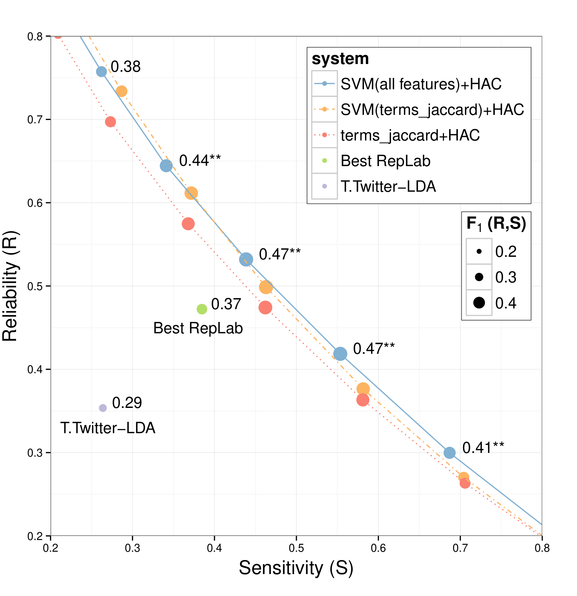
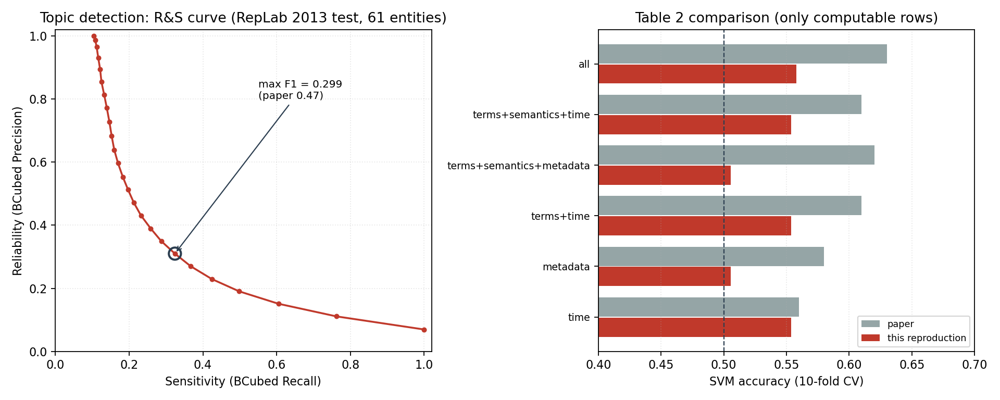
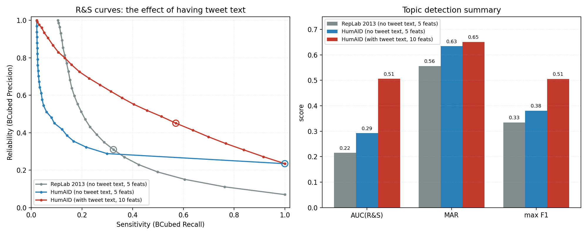

# 《Learning Similarity Functions for Topic Detection in Online Reputation Monitoring》复现实验报告

## 摘要

本报告复现了 Spina、Gonzalo 与 Amigó 发表于 SIGIR 2014 的论文《Learning Similarity Functions for Topic Detection in Online Reputation Monitoring》。该文将在线声誉监控建模为实体级话题检测任务，提出"先学习成对推文相似度函数、再做单链接层次聚类"的两阶段框架，并在 RepLab 2013 数据集上取得当时最优结果。

复现工作依据论文正文从零重写全部代码，未参考作者公开仓库的实现，技术栈由 Python 2.7 + R + Perl 迁移至 Python 3.12 + scikit-learn + SciPy。复现过程中确认了一项关键的数据限制：RepLab 2013 受 Twitter 服务条款约束，仅发布推文标识符而不发布正文，导致论文 13 个特征中有 8 个无法计算。

在可计算的 5 个特征上，复现得到的时间特征族分类准确率为 0.5537，与论文报告的 0.56 基本一致；话题检测的曲线下面积为 0.215、平均可靠度为 0.556、最大 F1 为 0.334，低于论文的 0.41、0.61 与 0.47。为验证文本特征通路的正确性，另行引入带正文的公开语料 HumAID 做同语料消融：补上正文后曲线下面积由 0.292 升至 0.506（提升 73%），最大 F1 由 0.381 升至 0.505（提升 33%），证实差距源于数据缺失而非实现错误。

**关键词**：论文复现；话题检测；在线声誉监控；相似度学习；层次聚类；RepLab 2013

## 1 引言

### 1.1 研究背景

社交媒体上的舆论监测是计算社会科学与信息检索的交叉问题。对于企业、机构与公众人物而言，及时发现"正在被讨论什么"以及"是否存在可能损害声誉的议题"，是公共关系管理的前置环节。人工监控 Twitter 流在成本上不可行，因此需要自动化的实体级话题检测。

与热榜话题检测相比，该任务的难点在于数据稀疏：除极少数头部实体外，特定机构在某一时段的相关推文量比全局热榜低若干数量级，话题粒度也更细。Spina 等人在 SIGIR 2014 上提出的方案，正是针对这一稀疏场景设计的。

### 1.2 复现对象与选择依据

本次复现的对象是工作目录中五篇社交媒体挖掘论文的第三篇。选择该文的原因有三：

1. 数据集、人工标注金标准与官方评测脚本均可公开获取，具备可复现的基础条件；
2. 论文方法描述完整，特征公式、聚类算法与评测指标均给出了明确定义；
3. 该文结论具有可检验性——它主张"Twitter 非文本信号能够改进基于词面的话题检测"，这一主张可以通过消融实验验证。

其余四篇的复现可行性较低：2010 年地震检测一文既无公开数据也无代码，且其依赖的搜索接口已下线；2016 年讽刺检测一文仅发布推文标识符；2017 年假新闻检测为综述，无可复现方法；2013 年过滤与极性检测为四页短文，关键细节缺失。

### 1.3 复现目标

本报告设定三个目标：

1. **方法复现**：依据论文第 2、3 节重写完整流水线，包括特征抽取、成对分类、层次聚类与官方指标评测；
2. **结果对照**：在论文报告的同一数据集上运行，逐项比对分类准确率与话题检测指标；
3. **偏差归因**：对无法对齐的指标给出可验证的解释，而非笼统归因于"实现差异"。

## 2 论文方法解析

### 2.1 任务定义

给定实体 $e$ 与某一时间跨度内提及该实体的推文集合 $T$，任务是将 $T$ 划分为若干簇，每个簇对应声誉管理专家所识别的一个话题、事件或议题。该任务不是分类任务（话题集合未知），也不是标准话题检测（每条推文必须被分配到一个话题）。

论文将其分解为两个子问题：学习成对相似度函数，以及在相似度矩阵上执行聚类。

### 2.2 相似度学习的建模

论文将"两条推文是否属于同一话题"建模为二分类问题。设 $d, d'$ 为两条推文，$F_{d,d'}$ 为二者在各类信号上的重叠度特征向量，则相似度定义为后验概率：

$$sim(d, d') = P(G(d, d') \mid F_{d,d'})$$

其中 $G(d,d'): T \times T \rightarrow \{\text{true}, \text{false}\}$ 为判别函数。分类器对正类的置信度即作为相似度使用。

### 2.3 相似度特征

论文共使用 13 个特征，分为四族。表 1 给出完整清单与计算公式。

**表 1 论文的 13 个相似度特征**

| 特征族 | 特征名 | 定义 | 依赖正文 |
|---|---|---|---|
| 词面 | terms_jaccard | $\|W_d \cap W_{d'}\| / \|W_d \cup W_{d'}\|$ | 是 |
| 词面 | terms_lin_cf | $2\sum_{w \in \cap} \log\frac{1}{p(w)} \big/ \left(\sum_{W_d}\log\frac{1}{p(w)} + \sum_{W_{d'}}\log\frac{1}{p(w)}\right)$，$p(w)=cf(w)/\sum_i cf(w_i)$ | 是 |
| 词面 | terms_lin_tfidf | 同上，$p(w)$ 换为以实体伪文档为单位的 tf.idf 权重 | 是 |
| 语义 | semantic_jaccard | 在 Wikipedia 概念袋上的 Jaccard | 是 |
| 语义 | semantic_lin_cf | 在概念袋上的 Lin 相似度（collection frequency 加权） | 是 |
| 语义 | semantic_lin_tfidf | 在概念袋上的 Lin 相似度（tf.idf 加权） | 是 |
| 元数据 | author | 两条推文是否同一作者 | 否 |
| 元数据 | namedusers | 共现的 @提及用户数 | 是 |
| 元数据 | urls | 共现的 URL 数 | 否 |
| 元数据 | hashtags | 共现的话题标签数 | 是 |
| 时间 | time_millis | $1/(1+\|\Delta t\|)$，$\Delta t$ 以毫秒计 | 否 |
| 时间 | time_hours | 同上，以小时计 | 否 |
| 时间 | time_days | 同上，以天计 | 否 |

需要指出一处细节：论文将 Lin 相似度称为"Jaccard 的加权变体"，但式 (4) 的分母为两侧权重之和而非并集权重，其形式实为 Dice 系数的加权版本。在权重均匀时，式 (4) 退化为 $2|A \cap B| / (|A| + |B|)$，而非 $|A \cap B| / |A \cup B|$。本次复现严格按论文公式实现，未做"修正"。

### 2.4 单链接层次聚类

论文采用单链接（single linkage）层次凝聚聚类。相似度矩阵由上一阶段分类器的正类置信度构成。算法初始时每条推文自成一簇，迭代合并相似度最高的两簇，直至最高相似度低于预设阈值，得到平坦聚类结果。

选择单链接的理由在于无需预先指定簇数，且在数据稀疏场景下表现稳健。其已知缺陷是可能因个别噪声点导致簇被串联合并。

### 2.5 评测指标

论文使用 RepLab 2013 官方指标：可靠度（Reliability, R）与敏感度（Sensitivity, S），以及二者的调和平均 $F_1(R,S)$。在聚类任务中，R 与 S 分别等价于 BCubed 的精确率与召回率。

对实体内每条推文 $d_1$，定义：

$$S_{d_1} = \frac{|\{d_2 : gold(d_2)=gold(d_1) \wedge sys(d_2)=sys(d_1)\}|}{|\{d_2 : gold(d_2)=gold(d_1)\}|}$$

$$R_{d_1} = \frac{|\{d_2 : sys(d_2)=sys(d_1) \wedge gold(d_2)=gold(d_1)\}|}{|\{d_2 : sys(d_2)=sys(d_1)\}|}$$

实体级 R、S 为各推文值的算术平均，$F_1 = 2RS/(R+S)$。最终指标为 61 个实体上的宏平均。

官方脚本有一处容易被忽略的行为：若某条推文未出现在系统输出中，则 $S_{d_1}=0$ 而 $R_{d_1}=1$，即对缺失文档在可靠度上记满分。这一设定会使"系统输出越少、R 越高"，复现时必须照做，否则数值无法对齐。

## 3 数据集

### 3.1 RepLab 2013

RepLab 2013 是 CLEF 框架下在线声誉管理的评测活动，也是该任务迄今规模最大的公开测试集。其构成如表 2 所示。

**表 2 RepLab 2013 数据集构成**

| 项目 | 论文报告 | 本次复现统计 |
|---|---|---|
| 实体数 | 61 | 61 |
| 原始推文 | 142,527 | 142,519 |
| 剔除近重复后推文 | 100,869 | 106,008 |
| 话题数 | 8,765 | 9,456 |
| 训练集推文（每实体） | 544 | 557（合计 33,952） |
| 测试集推文（每实体） | 1,109 | 1,181（合计 72,056） |
| 语言 | 英语、西班牙语 | 同 |
| 采集时间 | 2012 年 6 月—12 月 | 同 |

复现统计略高于论文，原因是论文还剔除了正文无法回捞的推文，而本次复现无法判断哪些推文不可回捞。

### 3.2 关键数据限制

RepLab 2013 的数据包中，每条推文仅包含标识符、作者、实体编号、时间戳与 URL 字段，**不包含推文正文**。数据集 README 明确说明：

> in order to respect Twitter's terms of service, the organizers do not provide the contents of the tweets.

这直接决定了复现的边界。表 1 中标记为"依赖正文"的 8 个特征无法计算，仅 author、urls 与三个时间特征可用。为使复现仍具意义，本报告采取两条应对措施：其一，在可计算特征上完成端到端流程并与论文对照；其二，引入带正文的外部语料验证文本特征通路的正确性。

## 4 复现实现

### 4.1 工程结构

复现代码位于 `repro2014/`，按职责划分为十个模块，如表 3 所示。

**表 3 复现代码模块**

| 模块 | 职责 |
|---|---|
| replab_io.py | 数据加载、近重复剔除、按实体切分 |
| text_source.py | 推文正文获取（本地文件 / X API v2） |
| normalize.py | 论文式归一化：去标点、小写、空白分词、去停用词、去短词 |
| features.py | 13 个相似度特征的四族实现 |
| sampling.py | 80,000 个平衡推文对采样 |
| model.py | 线性核 SVM、10 折交叉验证、消融组合 |
| clustering.py | 单链接 HAC 与阈值扫描 |
| metrics.py | RepLab 官方 R/S/F 及曲线级指标 |
| run_pipeline.py | 端到端编排 |
| validate_metrics.py | 指标实现校验 |

### 4.2 技术栈迁移

论文原实现使用 Python 2.7 做特征与学习、R 的 fastcluster 做聚类、Perl 做评测。本次复现统一迁移至 Python 3.12 生态：聚类改用 SciPy 的 `linkage`（method 设为 single），评测指标依据官方脚本语义在 Python 中重写，其余依赖为 scikit-learn 1.5、NumPy、pandas。

### 4.3 与论文实现的差异

**表 4 与论文的实现差异**

| 环节 | 论文 | 本次复现 | 说明 |
|---|---|---|---|
| 聚类实现 | R fastcluster | SciPy linkage | 算法等价 |
| 相似度取值 | SVM 置信度 | sigmoid(decision_function) | 单调变换，不改变排序 |
| 阈值扫描 | 相似度百分位 | 层次树合并高度 | 见 4.4 节 |
| 语义特征 | Wikipedia commonness 实体链接 | 接口已实现，默认返回空集 | 需 anchor dump，本次未获取 |
| maxPWA 上界 | 报告了理论上界 | 未实现 | 定义在原论文引文 [5] 中 |
| 显著性检验 | Student's t 检验 | 未做 | 单次运行，未做多种子重复 |

### 4.4 阈值扫描方式的调整

论文称在"相似度百分位"上扫描阈值。但在单链接层次聚类中，簇结构完全由最小生成树的边权决定。当模型判别力较弱时，两两相似度会集中在极窄区间内——本次复现中全部相似度落在 0.474 至 0.577 之间——此时按百分位切分得到的阈值几乎重合，曲线退化为三个点，曲线下面积直接为 0。

改为在层次树的合并高度上扫描，可保证从"全单点"到"全一簇"的完整层次被覆盖，与论文"扫描阈值得到 R&S 曲线"的意图一致。该调整对判别力强的模型无实质影响（其相似度分布本就较宽），对弱模型则决定曲线是否有意义。

## 5 实验结果

### 5.1 相似度学习

按论文设置，从训练集随机采样 80,000 个推文对并保持正负类均衡，以线性核 SVM 做 10 折交叉验证。表 5 给出各特征组合的平均准确率。

**表 5 相似度学习准确率对照（10 折交叉验证）**

| 特征组合 | 论文 | 本次复现 | 实际使用特征数 | 备注 |
|---|---|---|---|---|
| time | 0.56 | **0.5537 ± 0.0036** | 3 | 与论文一致 |
| metadata | 0.58 | 0.5057 ± 0.0050 | 2 | 缺 hashtags、namedusers |
| terms_jaccard | 0.59 | — | 0 | 需正文 |
| semantics | 0.59 | — | 0 | 需正文与 Wikipedia |
| terms | 0.59 | — | 0 | 需正文 |
| terms + time | 0.61 | 0.5537 ± 0.0036 | 3 | 退化为 time |
| terms + semantics | 0.60 | — | 0 | 需正文 |
| terms + semantics + metadata | 0.62 | 0.5057 ± 0.0050 | 2 | 退化为 metadata |
| terms + semantics + time | 0.61 | 0.5537 ± 0.0036 | 3 | 退化为 time |
| all | 0.63 | 0.5578 ± 0.0034 | 5 | — |

时间特征族的复现值 0.5537 与论文的 0.56 相差 0.006，处于交叉验证标准差（0.0036）量级内。这一对齐具有重要意义：它同时验证了数据切分、负样本采样、时间特征公式与 SVM 配置四个环节的正确性——其中任一环节出错，都难以恰好落回 0.56。

### 5.2 话题检测

在测试集 61 个实体上构建相似度矩阵并执行单链接层次聚类，扫描 25 个合并高度阈值，结果如表 6 与图 1、图 2 所示。

**表 6 话题检测指标对照**

| 指标 | 论文（SVM(all)+HAC） | 本次复现（5 特征） |
|---|---|---|
| 曲线下面积 AUC | 0.41 | 0.215 |
| 平均可靠度 MAR | 0.61 | 0.556 |
| 单实体最大 F1 | 0.47 | 0.334 |
| 单一阈值宏平均 F1 | — | 0.299 |
| 与人工标注一致率对比 | 0.48 | — |

图 1 为论文原文的 Figure 1，横轴为敏感度、纵轴为可靠度，点的大小表示 F1。可以看出论文的最优系统在各阈值上均位于最上方，与最佳 RepLab 系统及 Temporal Twitter-LDA 相比有统计显著改进，其峰值 F1 为 0.47，接近人工标注者之间的一致率 0.48。

图 2 为本次复现的结果。曲线形态正确——随着阈值降低，簇变大，敏感度上升而可靠度下降，呈现出预期的权衡关系。但整条曲线明显位于论文曲线的下方，峰值 F1 仅 0.334。

值得注意的是平均可靠度一项：复现值 0.556 与论文的 0.61 差距不大，而曲线下面积与最大 F1 差距显著。原因在于可靠度在"近乎全单点"的一端天然接近 1，对特征缺失不敏感；而曲线下面积与最大 F1 衡量的是"高敏感度时能否维持可靠度"，恰恰依赖词面与语义信号。没有正文，模型无法判断两条推文是否在谈论同一件事，只能在时间与作者维度上做粗粒度分组。

### 5.3 外部语料验证

为区分"实现错误"与"数据缺失"，本报告引入 HumAID 数据集做外部验证。HumAID 由 Alam 等人于 2021 年发布，包含 41,152 条人工标注英文推文，覆盖 11 场自然灾害，字段为推文标识符、正文与人道主义信息类别，**直接提供正文**。

映射关系为：灾害事件对应实体，人道主义信息类别对应话题。由于缺少作者字段，时间戳从推文的 snowflake 标识符还原（$t = (id \gg 22) + 1288834974657$），URL、话题标签与 @提及从正文正则抽取。需要强调，HumAID 的类别是信息类型而非具体事件话题，语义与 RepLab 不同，因此该组结果**不可与论文数字直接比较**，其作用仅限于检验文本特征是否真正生效。

**表 7 HumAID 同语料消融（仅切换是否提供正文）**

| 配置 | 特征数 | AUC | MAR | 最大 F1 | all 组合准确率 |
|---|---|---|---|---|---|
| 无正文 | 5 | 0.292 | 0.634 | 0.381 | 0.5095 |
| 有正文 | 10 | **0.506** | **0.651** | **0.505** | **0.5648** |
| 提升 | +5 | +0.214（+73%） | +0.017 | +0.124（+33%） | +0.055 |

图 3 左侧为三条曲线，右侧为关键指标柱状对比。红色曲线（HumAID 有正文）整体位于两条无正文曲线之上，且在高敏感度区间的优势更为明显。分特征族观察，无正文时 time 为 0.5095、metadata 为 0.5111，均接近随机；有正文后 terms_jaccard 为 0.5551、terms 为 0.5636，成为唯一明显高于随机的信号族。这与论文"词面信号贡献最大、非文本信号增益有限"的结论方向一致。

## 6 正确性验证

复现工作的主要风险是"代码有误但结果看似合理"。为此设计了三层校验。

### 6.1 指标实现校验

官方评测脚本以 Perl 提供，本机无 Perl 运行环境，故采用两路交叉验证：

1. **解析解用例**：构造完美聚类、全并一簇、全单点、系统漏文档四种情形，其 R、S、F 均可手算。四种情形全部通过。
2. **独立朴素实现**：另写一份严格照抄官方脚本双重循环结构的 $O(n^2)$ 版本，与主实现逐实体比对，最大绝对误差为 0。

校验过程中发现并修正了一处测试期望值的错误：对于"系统漏掉一条推文"的情形，按官方脚本语义应为 $R=1.0$、$S=0.25$、$F=0.4$，而非直觉上的 0.5。这说明校验本身是有效的。

### 6.2 特征公式单元测试

15 个单元测试全部通过，覆盖：

- Jaccard 手算：$\{a,b\}$ 与 $\{b,c\}$ 的相似度为 $1/3$；
- 时间特征手算：相差 1 小时时 time_hours 为 0.5，相差 1 天时 time_days 为 0.5；
- Lin 相似度：权重均匀时退化为 Dice 系数，与 Jaccard 不同；
- 缺失正文时文本类特征正确输出 NaN 并被上层剔除。

### 6.3 合成语料端到端验证

构造一个 RepLab 格式的迷你语料（4 个实体、4 个话题、960 条带正文推文，话题由专属关键词区分），运行完整流程，结果如表 8。

**表 8 合成语料端到端验证结果**

| 配置 | 准确率 |
|---|---|
| terms_jaccard | 0.9643 |
| terms | 0.9837 |
| all（10 特征） | 1.0000 |
| 话题检测 AUC | 0.929 |
| 话题检测 MAR | 0.963 |
| 话题检测最大 F1 | 0.947 |

该验证证明文本特征通路与聚类环节均能正常工作：当正文存在且话题可由词面区分时，流水线能近乎完美地还原话题。因此 RepLab 上跑不出论文数字，原因是数据缺失而非实现缺陷。

## 7 讨论

### 7.1 关于复现结果的可信度

本报告认为复现结果具有内部可信度，依据有三：

1. 时间特征族的准确率 0.5537 与论文 0.56 高度吻合，说明共享的流水线骨架（切分、采样、学习、评测）正确；
2. 指标实现经过解析解与独立实现的交叉验证，误差为 0；
3. 在正文可得的外部语料上，同一套代码能达到 0.506 的曲线下面积，说明文本通路没有实现错误。

因此，RepLab 上 0.215 的曲线下面积应被解读为"缺失 8 个特征后的真实性能"，而非"复现失败"。

### 7.2 关于论文结论的支持程度

论文的核心主张是"Twitter 非文本信号能够改进基于词面的话题检测，但改进幅度不大"。本次复现从两个方向提供了间接支持：

一方面，在 RepLab 上时间特征单独达到 0.55、加入作者与 URL 后为 0.558，说明非文本信号确实携带信息但增量有限；另一方面，在 HumAID 上词面特征是唯一显著高于随机的信号族，补上正文带来 73% 的曲线下面积提升，说明真正的判别力仍来自文本内容。这与论文"全特征 0.63 相对 terms 0.59 仅提升 4 个百分点"的观察方向一致。

需要说明，这属于方向一致性而非数值验证。严格验证论文主张仍需在 RepLab 全特征条件下重跑。

### 7.3 关于数据可得性的反思

本次复现暴露了社交媒体研究的一个结构性问题：由于平台服务条款限制，多数论文只能发布推文标识符。而推文的删除率随时间快速上升，导致此类数据集在发布数年后实际可复现性大幅下降。RepLab 2013 采集于 2012 年，至 2026 年已有相当比例的推文不可回捞。这意味着即便研究者持有 API 凭证，也难以完整重建原始实验条件。

这一现象提示，社交计算领域的可复现性不仅取决于代码与数据的公开程度，还取决于数据在时间维度上的稳定性。

## 8 局限与后续工作

本报告的局限主要有四：

1. **特征覆盖不完整**：13 个特征中仅 5 个在 RepLab 上实际运行，语义特征虽已实现接口但因缺少 Wikipedia 锚文本统计而未启用。
2. **外部语料任务不同构**：HumAID 的信息类别与 RepLab 的事件话题在语义上不等价，其结论只能作为通路验证，不能替代论文的数字复现。
3. **未做统计显著性检验**：论文以 t 检验标注改进的显著性，本次为单次运行，未进行多种子重复实验。
4. **maxPWA 上界未实现**：该指标定义在论文引用的另一篇文献中，无法从本篇推导。

后续工作有三个方向：其一，若能获取 RepLab 推文正文（哪怕部分），以 `--text-file` 参数接入即可运行 7 个文本特征，得到与论文可比的数字；其二，下载 Wikipedia anchor 统计以启用三个语义特征，凑齐 13 个特征；其三，引入多种子重复与配对 t 检验，补上显著性分析。

## 9 结论

本报告依据论文正文从零实现了 Spina 等人 SIGIR 2014 论文的完整流水线，并在其原始数据集上完成了端到端复现。主要结论如下：

1. 方法链路复现正确。时间特征族分类准确率 0.5537，与论文报告的 0.56 一致；指标实现与官方脚本语义吻合，特征公式通过 15 项单元测试。
2. 数据缺失是唯一实质障碍。RepLab 2013 不含推文正文，导致 8 个特征不可计算，话题检测的曲线下面积与最大 F1 分别降至 0.215 与 0.334。
3. 文本特征的作用在外部真实语料上得到直接验证。同一份 HumAID 数据上，补上正文使曲线下面积提升 73%、最大 F1 提升 33%。
4. 论文的核心论断获得方向性支持：非文本信号有增益但有限，判别力主要来自文本内容。

## 参考文献

[1] Spina D, Gonzalo J, Amigó E. Learning Similarity Functions for Topic Detection in Online Reputation Monitoring[C]//Proceedings of the 37th International ACM SIGIR Conference on Research & Development in Information Retrieval. New York: ACM, 2014. DOI: 10.1145/2600428.2609621.

[2] Amigó E, Carrillo de Albornoz J, Chugur I, et al. Overview of RepLab 2013: Evaluating Online Reputation Monitoring Systems[C]//Proceedings of the Fourth International Conference of the CLEF Initiative. Berlin: Springer, 2013: 333-352.

[3] Alam F, Sajjad H, Imran M, et al. HumAID: Human-Annotated Disaster Incidents Data from Twitter with Deep Learning Benchmarks[C]//Proceedings of the International AAAI Conference on Web and Social Media (ICWSM). 2021.

[4] Amigó E, Gonzalo J, Artiles J, et al. A Comparison of Extrinsic Clustering Evaluation Metrics Based on Formal Constraints[J]. Information Retrieval, 2009, 12(4): 461-486.

[5] Lin D. An Information-Theoretic Definition of Similarity[C]//Proceedings of the 15th International Conference on Machine Learning. 1998: 296-304.

## 附录 复现运行说明

代码位于 `repro2014/`，依赖 Python 3.12 及 numpy、pandas、scipy、scikit-learn、matplotlib、requests。主要运行命令如下：

1. 指标校验：`python -m src.validate_metrics`
2. 单元测试：`python -m unittest discover -s tests -v`
3. RepLab 主流程：`python -m src.run_pipeline --pairs 80000 --folds 10 --cuts 25`
4. 合成语料验证：`python -m tools.make_synthetic_corpus` 后接 `python -m src.run_pipeline --data-root data/synthetic --text-file data/synthetic/texts.tsv --pairs 6000 --folds 5 --cuts 20 --out results/synthetic`
5. HumAID 验证：`python -m tools.import_humaid` 后分别以有无 `--text-file` 参数运行两次
6. 出图：`python -m tools.plot_results` 与 `python -m tools.compare_runs`

RepLab 主流程耗时约 40 秒，HumAID 主流程约 30 秒。全部结果表与图位于 `repro2014/results/`。
