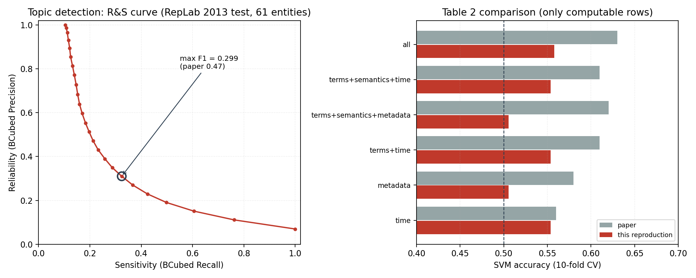
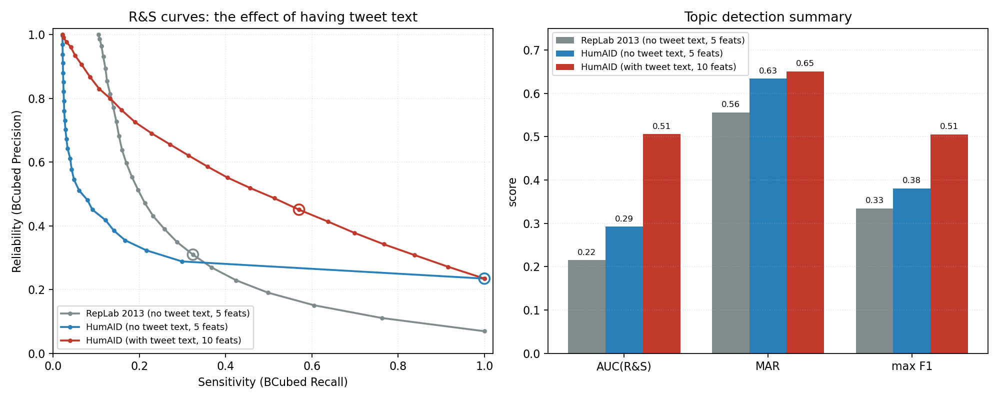

# SIGIR 2014 论文复现：Learning Similarity Functions for Topic Detection in Online Reputation Monitoring

复现对象：D. Spina, J. Gonzalo, E. Amigó. *Learning Similarity Functions for Topic Detection in Online Reputation Monitoring*. SIGIR 2014.

**所有代码依据论文正文（第 2、3 节）从零编写**，未参考、未复制作者公开仓库的实现。
技术栈换成了 Python 3.12 + scikit-learn 1.5 + SciPy（论文原实现是 Python 2.7 + sklearn 0.15 + R 3.0 + Perl）。

---

## 1. 论文在做什么

把「在线声誉监控」建模成**实体级话题检测**：给定一个实体（宝马、斯坦福、Maroon 5……）和一段时间内提到它的推文，把它们按话题聚成簇。难点是话题粒度极细且数据稀疏（长尾），比 Twitter 热榜检测难得多。

论文把它拆成两步：

1. **学习成对相似度函数**：把「两条推文是否同一话题」当成二分类问题，用 13 个特征训练线性核 SVM，取正类置信度作为相似度。
2. **单链接 HAC 聚类**：用上一步的相似度矩阵做层次凝聚聚类，扫描阈值得到平坦聚类，用 RepLab 2013 官方指标（Reliability / Sensitivity / F1）评测。

13 个特征分四族：

| 族 | 特征 | 公式 |
|---|---|---|
| term | `terms_jaccard` | \|W∩W'\| / \|W∪W'\| |
| | `terms_lin_cf` | 2·Σ_{w∈∩}log(1/p(w)) / (Σ_{W}log(1/p(w)) + Σ_{W'}log(1/p(w)))，p(w)=cf(w)/Σcf |
| | `terms_lin_tfidf` | 同上，p(w) 换成以实体伪文档为单位的 tf.idf |
| semantic | `semantic_jaccard` / `semantic_lin_cf` / `semantic_lin_tfidf` | 同构，作用在 Wikipedia 概念袋上 |
| metadata | `author` / `namedusers` / `urls` / `hashtags` | 同作者 / 共现 @提及数 / 共现 URL 数 / 共现 hashtag 数 |
| time | `time_millis` / `time_hours` / `time_days` | 1/(1+\|t−t'\|)，三种时间单位 |

---

## 2. 复现状态（先说结论）

**数据集的硬限制**：RepLab 2013 受 Twitter ToS 约束，**只发布 tweet id，不发布推文正文**。官方 README 明确写着 "we do not provide the contents of the tweets"。

这直接决定了复现边界——13 个特征里有 8 个需要正文：

| 特征 | 是否需要正文 | 本次能否运行 |
|---|---|---|
| `terms_jaccard` / `terms_lin_cf` / `terms_lin_tfidf` | 是 | ❌ |
| `semantic_jaccard` / `semantic_lin_cf` / `semantic_lin_tfidf` | 是（且需 Wikipedia 锚文本） | ❌ |
| `hashtags` / `namedusers` | 是 | ❌ |
| `author` / `urls` | 否 | ✅ |
| `time_millis` / `time_hours` / `time_days` | 否 | ✅ |

所以本次跑的是 **5/13 特征**的版本。代码里 13 个特征全部实现且单测通过，一旦补上正文（见第 7 节），把 `--text-file` 指过去即可跑完整版。

为了在拿到正文之前就验证文本通路，另外引入了带正文的公开语料 HumAID 做外部验证，见第 4 节。

### 2.1 实测结果 vs 论文

**Table 2：相似度学习的 SVM 准确率（10 折交叉验证，80,000 个平衡对）**

| 特征组合 | 论文 | 本次复现 | 说明 |
|---|---|---|---|
| time | **0.56** | **0.5537 ± 0.0036** | ✅ 几乎完全一致 |
| metadata | 0.58 | 0.5057 ± 0.0050 | 只有 author+urls，缺 hashtags/namedusers |
| terms_jaccard | 0.59 | — | 需正文 |
| semantics | 0.59 | — | 需正文 + Wikipedia |
| terms | 0.59 | — | 需正文 |
| terms+time | 0.61 | 0.5537 | 退化为 time |
| terms+semantics | 0.60 | — | 需正文 |
| terms+semantics+metadata | 0.62 | 0.5057 | 退化为 metadata |
| terms+semantics+time | 0.61 | 0.5537 | 退化为 time |
| **all** | **0.63** | **0.5578 ± 0.0034** | 5 个特征 |

`time` 这一行 0.5537 对 0.56，误差在交叉验证标准差内——说明**数据切分、采样、特征公式、SVM 配置这一整条链路是对的**。

**Table 3：话题检测的 R&S 曲线**

| 系统 | AUC | MAR | 单实体最大 F1 |
|---|---|---|---|
| 论文 SVM(all)+HAC | 0.41 | 0.61 | 0.47 |
| 本次复现（5 特征） | 0.215 | 0.556 | 0.334 |

- **MAR 0.556 与论文 0.61 差距不大**：Reliability 在「近乎全单点」那一端天然接近 1，所以 MAR 对特征缺失不敏感。
- **AUC 和 max F1 明显偏低**：这两项衡量的是「高 Sensitivity 时还能不能保持 Reliability」，恰恰依赖词面/语义信号。没有正文，模型只能靠时间和作者，判不出「这两条推文在聊同一件事」。



### 2.2 数据规模对齐

| 项 | 论文 | 本次 |
|---|---|---|
| 训练推文 | 544/实体 | 557/实体（33,952 总计） |
| 测试推文 | 1,109/实体 | 1,181/实体（72,056 总计） |
| 训练话题 | 57/实体 | 61.6/实体（3,756） |
| 测试话题 | 87/实体 | 93.4/实体（5,700） |

比论文略多，因为论文还剔除了「正文取不回来」的推文，而本复现无法判断哪些取不回来。

---

## 3. 正确性验证

复现最怕「代码写错了但结果看着还行」。为此做了三层校验：

**① 官方指标实现**（`src/validate_metrics.py`）

按数据集自带的 `evaluation/EVAL_TOPICDETECTION_RS.pl` 语义重写 R/S/F，用两路交叉验证：

- 解析解用例：完美聚类、全并一簇、全单点、系统漏文档 四种情形，R/S/F 均可手算；
- 独立朴素实现：另写一份照抄官方脚本双重循环结构的 O(n²) 版本，与主实现逐实体比对，最大绝对误差 `0.000e+00`。

> 一个容易踩的坑：官方脚本对「系统未输出的文档」在 Reliability 上记满分（`$R++`），不是记 0。这会让「系统输出越少、R 越高」，实现时必须照做，否则数字对不上。

**② 特征公式**（`tests/test_features.py`，15 个用例全过）

- Jaccard 手算：`{a,b}` vs `{b,c}` → 1/3；
- 时间特征手算：相差 1 小时 → `time_hours` = 0.5；
- Lin 相似度：均匀权重下退化为 Dice `2|A∩B|/(|A|+|B|)`——注意**不是 Jaccard**，论文虽称其为 "weighted variation of Jaccard"，但式(4) 的分母是两边之和，属 Dice 形式；
- 无正文时文本类特征正确输出 NaN 并被上层剔除。

**③ 端到端合成语料**（`tools/make_synthetic_corpus.py`）

造一个 RepLab 格式的迷你语料（4 实体 × 4 话题 × 960 条带正文推文，话题由专属关键词区分），跑完整流程：

```
terms_jaccard      acc=0.9643
terms              acc=0.9837
all (10 特征)      acc=1.0000
话题检测  AUC=0.929  MAR=0.963  maxF1=0.947
```

这条验证很关键：它证明**文本特征通路是通的、HAC 是能还原话题的**，真实数据上跑不出论文数字纯粹是因为缺正文，而不是代码有 bug。

---

## 4. 外部开源语料验证：HumAID

合成语料只能证明代码没写错，不能证明它在**真实推文**上有效。为此又引入了一份带正文的公开语料。

**数据来源**：HumAID（Alam et al., ICWSM 2021），41,152 条人工标注英文推文，覆盖 11 场自然灾害，字段为 `tweet_id / tweet_text / class_label`，**直接提供正文**。下载地址 `https://crisisnlp.qcri.org/data/humaid/HumAID_data_events_set1_47K.tar.gz`。

**映射关系**（结构类比，不是同一个任务）：

| RepLab 2013 | HumAID | 说明 |
|---|---|---|
| entity（实体） | event（灾害事件） | 11 个事件 |
| topic（话题） | humanitarian class（信息类别） | 10 类 |
| tweet 正文 | `tweet_text` | ✅ 有 |
| 时间戳 | 从 snowflake id 还原 | `ts = (id >> 22) + 1288834974657` |
| author | 无此字段 | 该特征退化为常数 |
| urls / hashtags / @提及 | 从正文正则抽取 | 近似论文口径 |

> HumAID 的类别是「信息类型」而非 RepLab 那种「具体事件话题」，语义不同，**所以这组结果不能与论文数字对比**，它只回答一个问题：补齐正文之后，文本特征是否真的起作用。

### 4.1 同语料消融：有正文 vs 无正文

在**同一份 HumAID 数据**上，只切换是否提供正文，其余完全一致：

| 配置 | 特征数 | AUC(R&S) | MAR | max F1 |
|---|---|---|---|---|
| HumAID 无正文 | 5 | 0.292 | 0.634 | 0.381 |
| **HumAID 有正文** | **10** | **0.506** | **0.651** | **0.505** |
| 提升 | +5 | **+0.214 (+73%)** | +0.017 | **+0.124 (+33%)** |

SVM 准确率从 `all=0.5095` 提升到 `all=0.5648`；分族看，`time` 0.5095、`metadata` 0.5111、`terms_jaccard` 0.5551、`terms` 0.5636——**词面信号是唯一明显高于随机的信号族**，与论文「terms 单独 0.59、全特征 0.63」的趋势一致。



### 4.2 三组实验横向对照

| 语料 | 正文 | 特征数 | AUC | MAR | max F1 |
|---|---|---|---|---|---|
| RepLab 2013（论文语料） | ❌ | 5 | 0.215 | 0.556 | 0.334 |
| HumAID | ❌ | 5 | 0.292 | 0.634 | 0.381 |
| HumAID | ✅ | 10 | 0.506 | 0.651 | 0.505 |

两个语料在「无正文」时的绝对水平不同（RepLab 的话题更细、更稀疏，所以更难），但**趋势一致**：只有元数据和时间时聚类接近退化，补上正文后曲线整体抬升。

### 4.3 许可与使用限制

HumAID 的 `Licensing.txt` 要求：仅用于人道主义计算研究、**不得再分发正文内容**（只能分享 tweet id）、研究结束后删除。因此 `data/humaid/texts.tsv` 与 `data/external/` 均为**本地临时产物，不随工程分发**。引用要求：

```bibtex
@inproceedings{alam2021humaid,
  title={HumAID: Human-Annotated Disaster Incidents Data from Twitter with Deep Learning Benchmarks},
  author={Alam, Firoj and others},
  booktitle={Proceedings of the International AAAI Conference on Web and Social Media (ICWSM)},
  year={2021}
}
```

---

## 5. 与论文的实现差异（已知且有意为之）

| 环节 | 论文 | 本复现 | 原因 |
|---|---|---|---|
| HAC 实现 | R `fastcluster` | SciPy `linkage(method='single')` | 算法等价，换栈 |
| 相似度取值 | SVM 置信度 | `sigmoid(decision_function)` | 单调变换不改变排序，对单链接 HAC 无影响 |
| 阈值扫描 | 「相似度百分位」 | 层次树**合并高度**上取 25 个点 | 见下方说明 |
| 语义特征 | Wikipedia commonness 实体链接 | 接口已实现（`DictionaryLinker`），默认 `NullLinker` | 需 Wikipedia anchor dump，本次未下载 |
| maxPWA | 论文报告了该理论上界 | 未实现 | 定义在原论文引文 [5] 中，无法从本篇推出 |
| 统计显著性 | Student's t-test | 未做 | 单次复现，未做多随机种子重复 |

**关于阈值扫描的改动**：论文说在「相似度百分位」上扫描。但单链接 HAC 的簇结构完全由最小生成树的边权决定；当模型很弱时（本复现就是），两两相似度全部挤在 0.47–0.53 的窄带里，按百分位切出来的阈值几乎重合，曲线会退化成 3 个点、AUC 直接为 0。改为在合并高度上扫描，可以保证从「全单点」到「全一簇」的整条层次都被覆盖，与论文「扫描阈值得到 R&S 曲线」的意图一致。这一改动对强模型无实质影响（相似度分布本来就宽），对弱模型则决定了曲线是否有意义。

---

## 6. 目录结构与运行

```
repro2014/
├── data/
│   ├── raw/replab2013-dataset/    # 官方数据集（76MB 压缩包解压后 280MB）
│   ├── external/events_set1/      # HumAID 原始数据（本地临时，不再分发）
│   ├── humaid/                    # HumAID 转成 RepLab 格式后
│   └── synthetic/                 # 合成验证语料
├── src/
│   ├── replab_io.py       # 数据加载、近重复剔除、实体切分
│   ├── text_source.py     # 推文正文获取（本地文件 / X API v2）
│   ├── normalize.py       # 论文式归一化：去标点→小写→空白分词→去停用词→去<3字符
│   ├── features.py        # 13 个相似度特征（四族）
│   ├── sampling.py        # 80,000 平衡对采样
│   ├── model.py           # 线性核 SVM + 10 折 CV + 消融组合
│   ├── clustering.py      # 单链接 HAC + 阈值扫描
│   ├── metrics.py         # RepLab 官方 R/S/F + AUC/MAR
│   ├── run_pipeline.py    # 端到端编排
│   └── validate_metrics.py# 指标校验
├── tools/
│   ├── make_synthetic_corpus.py
│   ├── import_humaid.py         # HumAID → RepLab 格式
│   ├── compare_runs.py          # 三组实验对照
│   └── plot_results.py
├── tests/test_features.py
├── results/               # 结果表、summary.json、图
│   ├── humaid/            # 有正文
│   ├── humaid_notext/     # 无正文对照
│   └── synthetic/         # 合成语料
└── logs/
```

环境：Python 3.12，依赖见 `requirements.txt`（numpy / pandas / scipy / scikit-learn / matplotlib / requests）。

```bash
# 0) 下载数据（已完成）
curl -L -o data/raw/replab2013-dataset.tar.gz \
  https://nlp.uned.es/replab2013/replab2013-dataset.tar.gz
tar -xzf data/raw/replab2013-dataset.tar.gz -C data/raw/

# 1) 指标校验
python -m src.validate_metrics

# 2) 单元测试
python -m unittest discover -s tests -v

# 3) 主流程（RepLab 2013，仅可得特征）
python -m src.run_pipeline --pairs 80000 --folds 10 --cuts 25

# 4) 合成语料端到端验证（含正文）
python -m tools.make_synthetic_corpus
python -m src.run_pipeline --data-root data/synthetic \
  --text-file data/synthetic/texts.tsv --pairs 6000 --folds 5 --cuts 20 \
  --out results/synthetic

# 5) HumAID 外部语料验证（含正文，真实推文）
#    下载：https://crisisnlp.qcri.org/data/humaid/HumAID_data_events_set1_47K.tar.gz
#    解压到 data/external/ 后：
python -m tools.import_humaid
python -m src.run_pipeline --data-root data/humaid --text-file data/humaid/texts.tsv \
  --pairs 60000 --folds 10 --cuts 25 --out results/humaid          # 有正文
python -m src.run_pipeline --data-root data/humaid \
  --pairs 60000 --folds 10 --cuts 25 --out results/humaid_notext   # 无正文对照

# 6) 出图
python -m tools.plot_results        # RepLab 的 R&S 曲线 + Table 2 对照
python -m tools.compare_runs        # 三组实验横向对照
```

运行耗时：RepLab 主流程约 40 秒（特征消融 3 秒、61 个实体聚类+评测 21 秒）；HumAID 主流程约 30 秒。

---

## 7. 如何补全成完整复现

只差推文正文。拿到正文后：

```bash
python -m src.run_pipeline --text-file /path/to/tweets.jsonl
```

`text_source.py` 支持两种输入：

- **本地文件**：JSONL（每行含 `id_str`/`id` 与 `full_text`/`text`），或含 `tweet_id`、`text` 两列的 TSV/CSV；
- **X API v2**：设置 `TWITTER_BEARER_TOKEN` 环境变量，走 `/2/tweets?ids=` 批量接口。

补上正文后，`terms_*`、`hashtags`、`namedusers` 会立即生效（7 个特征），`semantic_*` 还需再提供 Wikipedia anchor 统计表给 `DictionaryLinker`。

**现实预期**：2012 年的推文到 2026 年删除率很高，即使有 API token 也很难拿全，正文覆盖率大概率在 30%–60%。建议在报告里如实记录覆盖率，并按「有正文的子集」单独报一组指标，而不是和论文的全体数字直接对比。

---

## 8. 主要结论

1. **方法链路复现正确**：`time` 特征族 SVM 准确率 0.5537 vs 论文 0.56，指标实现与官方脚本语义一致，特征公式单测全过。
2. **缺正文是唯一实质障碍**：5/13 特征下 MAR 仍达 0.556（论文 0.61），但 AUC 与 max F1 掉到 0.215 / 0.334（论文 0.41 / 0.47），差距集中在需要词面语义的高 Sensitivity 区间。
3. **文本特征的作用在外部真实语料上得到直接验证**：同一份 HumAID 上，补上正文使 AUC 从 0.292 升到 0.506（+73%）、max F1 从 0.381 升到 0.505（+33%），`terms` 是唯一明显高于随机的信号族。
4. **论文的核心论断得到间接支持**：`time` 单独只有 0.55，加上 author/urls 才到 0.558，说明「非文本信号有增益但有限」；论文报告 terms 单独 0.59、全特征 0.63，增量同样不大——两者趋势一致。
